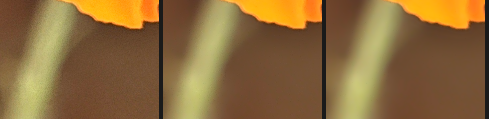

# Stage 10 — Effects and detail

## Goal

The Detail and Effects categories: Sharpen and Noise reduction; Clarity, Texture, Dehaze,
post-crop Vignette and Grain. All work at preview scale with radii scaled by the resolution,
so the preview shows what the export will be.

## Definition of Done

- [x] Goldens vs the Python implementations (`tools/golden/detail_reference.py`), with the
      He 2009 dark-channel dehaze as its own reference script
      (`tools/golden/dehaze_reference.py`; `generate.py` asserts Dehaze 100 equals it within
      1e-5): ctest `detail_test` (CPU, 1e-3: Sharpen ×4, Noise reduction ×3, Clarity ×2,
      Texture ×2, Dehaze ×3, Vignette ×3, Grain ×3, two of them at preview scale) and
      `EngineGpuTest` (one setting per op through the canvas's shaders, 3/255)
- [x] Preview-vs-export consistency: `detail_test.preview_matches_the_downsampled_export`
      (a 1024 × 768 image with every op at mid values exported in 512 px tiles with aprons,
      downsampled 4×, against the 4× smaller preview at scale 0.25): **PSNR 40.9 dB** (> 35)
- [x] CI green; APK built

## What was built

| Module | Content |
| --- | --- |
| `:core:engine-native` | `detail.h/.cpp`: Sharpen, Noise reduction, Clarity, Texture, Dehaze (CPU reference + GLSL), `computeDetailFields` (guided-filter coefficients of log luminance at 2 % and 0.3 %, the haze model), `Finishing` (post-crop Vignette, Grain) for CPU and GLSL. `ops.h`: `OpRegion::scale / fields / original`, `Op::apron() / readsOriginal()`, `GpuOpContext::addPass`. Android: multi-pass `runOps` (scratch slots, `u_prev / u_pass0 / u_original`), field textures, finishing in the display and warp programs, tile aprons (padded textures, rebuilt when neighbours arrive, neighbours requested), exports through footprint + apron, thumbnails with fields, scale and finishing |
| `:core:model` | `OpParams.Sharpen / NoiseReduction / Clarity / Texture / Dehaze / PostCropVignette / Grain`, `DetailAdjustments` + `DetailParam` + `DetailTools`, `editOps` order, History names |
| `:feature:editor` | `DetailPanel` (sliders with EndEdit, Masking's second-finger mask preview, the 1:1 chip), `EditorIntent.SetDetail / SharpenMaskPreview / ToggleOneToOne`, `canvasGraph` with the mask, `CanvasView.requestOneToOne` / `CanvasTransform.oneToOneTarget` |
| `:core:ui` | 7 tools `done` (162 tools, 52 done) |

Tests added: ctest `detail_test` (8: five golden suites, the graph mapping, the Kotlin
fixture, preview vs export); `testdata/graph/detail_v1.json` shared with
`DetailAdjustmentsTest` (8); editor `DetailEditingTest` (5), `DetailPanelScreenshots`
(3 sheets × 2 widths) and the `detail_panel` editor state; instrumented `EngineGpuTest` +7.

## Tools delivered

| id | Name | UI slot | Tests |
| --- | --- | --- | --- |
| `detail.sharpen` | Sharpen | `cat/Detail/01` | detail_test, EngineGpuTest, DetailEditingTest (mask), screenshots |
| `detail.noise_reduction` | Noise reduction | `cat/Detail/02` | detail_test, EngineGpuTest, screenshots |
| `effects.texture` | Texture | `cat/Effects/01` | detail_test, EngineGpuTest, screenshots |
| `effects.clarity` | Clarity | `cat/Effects/02` | detail_test, EngineGpuTest, DetailEditingTest, screenshots |
| `effects.dehaze` | Dehaze | `cat/Effects/03` | detail_test (He 2009), EngineGpuTest, screenshots |
| `effects.vignette` | Vignette (post-crop) | `cat/Effects/04` | detail_test, EngineGpuTest, screenshots |
| `effects.grain` | Grain | `cat/Effects/05` | detail_test (incl. preview scale), EngineGpuTest, screenshots |

`TOOL_CATALOG.md` updated: yes.

## Decisions and deviations

1. **Order.** Noise reduction, Clarity, Texture and Dehaze run right after the geometry's
   vignetting correction (on the image as decoded, before the colour work: denoising and
   haze removal want the camera's tones); Sharpen runs last in source space; Vignette and
   Grain are output-space finishing (after the crop, as "post-crop" requires).
2. **Fields once per preview** (the brief's IF WRONG rule, applied from the start): the
   guided-filter coefficients for Clarity / Texture and the haze model are computed in
   `setPreview` with the Highlights / Shadows coefficients, once per photo, not per slider
   move. A slider move reruns only the shader passes.
3. **Clarity / Texture as guided-filter detail.** Detail = log2 Y of the original minus its
   edge-aware base (self-guided filter, He 2015 fast form: coefficients box-filtered at
   preview size, sampled bilinearly). Clarity weights it 4·p·(1 − p) on encoded luminance
   (midtones); Texture uses the small radius at 70 % strength on all tones. Edge-aware bases
   avoid the halos of a Gaussian unsharp mask.
4. **Dehaze = He et al. 2009** with ω = 0.95 at Amount 100, t0 = 0.1, the airlight from the
   brightest 0.1 % of the dark channel, the transmission refined by the guided filter (radius
   4 × the 1 % patch, ε = 1e-3) instead of soft matting (He's own later practice). The refined
   dark channel is linear in ω, so the field is stored once and any Amount is
   `1 − 0.95·Amount·(a·grey + b)`. Negative values blend towards the airlight.
5. **Sharpen** works on encoded luminance (perceptual steps), the detail softly limited with
   tanh (Detail 0 keeps only fine detail, 100 lets wide halos through); Masking is a Sobel
   magnitude of the blurred luminance in units per full-resolution pixel.
6. **Noise reduction**: B3 a-trous wavelets with soft thresholds per level (finest first
   0.035, 0.02, 0.012, 0.006 at Luminance 100); Detail relaxes the two finest, Contrast puts
   back 60 % of what the coarse levels lost. Color: a 7 × 7 bilateral of Cb / Cr over
   1 + 6·Color/100 px, guided by chroma and Y' differences.
7. **Grain**: 2D gradient noise (Perlin, 8 gradients by a 32-bit hash identical in C++,
   GLSL and numpy) at cells of 1 + 3·Size/100 output pixels plus a finer octave
   (Roughness), weighted 0.25 + 3·Y'(1 − Y'). Where one pixel covers more than a cell (the
   zoomed-out canvas) each octave is attenuated by cell / footprint, so the preview matches the
   downsampled export instead of aliasing. The brief allowed blue-noise or Perlin; Perlin
   needs no texture asset and is exact on every path.
8. **Mask preview**: the second finger on Masking sets `showMask = 1` in the canvas graph
   only; the saved edit and History never carry it.
9. **1:1 toggle**: a chip in the Sharpen, Noise reduction and Texture headers; 100 % at the
   middle of the view, again to fit. The panel slot is unchanged (R9).

## Dependencies added (R10)

None.

## Golden images changed (R4)

No existing golden file changed (`generate.py --check`: 182 files up to date). New:
`testdata/golden/detail/` (Sharpen ×4, Noise reduction ×3, GPU references),
`testdata/golden/effects/` (Clarity, Texture, Dehaze, Vignette, Grain, GPU references),
`input/hazy_rec2020_f32.npy` (the HDR scene with synthetic haze, airlight
(0.86, 0.88, 0.92), transmission falling with height).

Screenshots changed, and why:

| Screenshot | Why |
| --- | --- |
| `editor/*/tool_panel` | The placeholder panel now shows `presets.presets` (Texture, its old subject, has a real panel) |
| `editor/expanded/category_effects`, `category_detail` | The seven tools say "Ready" instead of "Arrives in Stage 10" |
| `editor/*/detail_panel`, `editor/detail_panel/*` | New: the Detail and Effects panels |

## Troubleshooting log (R11)

| Symptom | Root cause | Fix |
| --- | --- | --- |
| Tiled export ≠ whole-image export by 1.2e-4 | Not the apron (a wider one gives 5e-7 or 3e-5, not monotone): float rounding of each tile's uv where the guided fields are sampled, amplified by Dehaze's 1 / t | Accepted under the float-op tolerance (1e-3); documented in the test |
| "Airlight 0.86" check failed | He's A is the brightest pixel of the densest haze, which is above the synthetic airlight | The test checks A ≥ the synthetic airlight and bluish |
| Warp program did not compile (`lo_finished` missing) | The finishing helper lived in the display main only | One `kFinished` snippet in the display and warp programs (all 17 shaders checked with glslangValidator) |
| `DetailAdjustments` read back ≠ written | Values at their default stored explicitly vs absent | Defaults are never stored |
| Mask preview did not reach the canvas | `setState` does not sync the canvas | `reduce` (the graph is unchanged, so no History step) |

Plan B used: no.

## Proof

- CI run and APK artifact: see the Stage 10 report

## Phone checklist

POCO F7 Ultra, `lineover-<sha>.apk`:

- [ ] Open a hazy landscape. Effects → Dehaze +60: the distance gains contrast and colour,
      the sky stays smooth. −40 adds haze.
- [ ] Open a night photo. Detail → Noise reduction → 1:1: the canvas zooms to 100 %.
      Luminance 50: the grain smooths, edges stay; Color 50: colour blotches go.
      Pan around at 100 %: no seams between tiles.
- [ ] Detail → Sharpen: Amount 80; hold a second finger on Masking and drag it: the photo
      turns grey (white = sharpened); release: the sharpened photo is back.
- [ ] Clarity, Texture: +50 / −50 at fit and at 100 %: the same look at both.
- [ ] Vignette −50 after a 4:5 crop: the corners of the crop darken, not the photo's.
- [ ] Grain 40 at 100 % and at fit: fine grain at 100 %, no shimmer when zoomed out.
- [ ] Export at full resolution: Sharpen, Noise reduction, Vignette and Grain look as on the
      canvas at 100 %.

## Open questions (R12)

1. **Is the noise reduction too smeary?** At 100 % on the darkest textured part of
   `IMG_20261031_165350.jpg` (shadows lifted +2 EV to stand in for a night photo; left:
   original, middle: Luminance 50 / Color 25, right: Luminance 100 / Color 50):
   
   Default if unanswered: keep these strengths (Detail 50 keeps the finest levels half).
